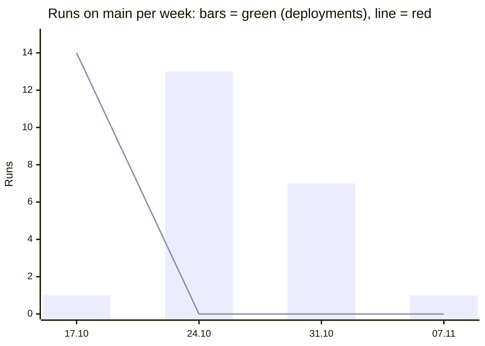
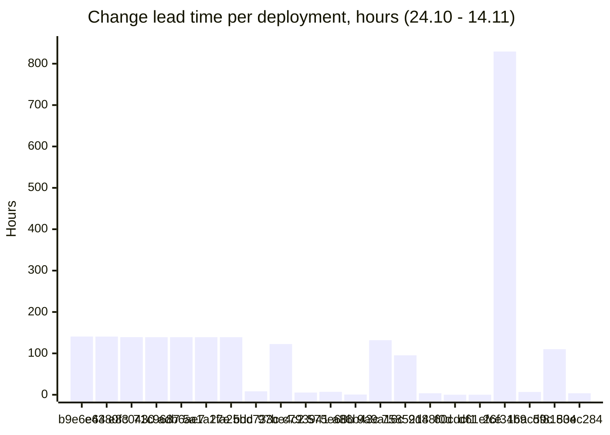
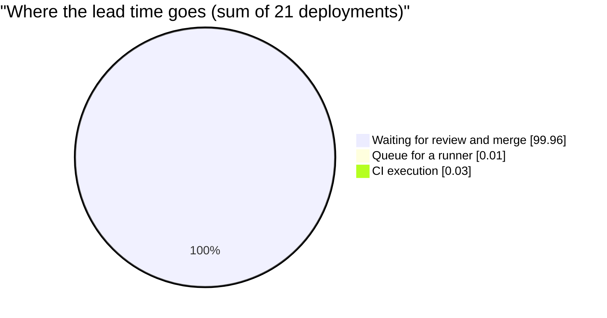

## DORA summary

Go back to the [Main README](../../README.md). Raw data: [metrics-raw.md](metrics-raw.md),
evidence: [evidence/](evidence/).

**Period:** 24.10.2026 – 14.11.2026, 3 weeks, 21 completed runs on `main`. For the
stability metrics the last incident (17.10 – 19.10) is also shown, because the period itself
has no red run.

### Deployment definition and counted workflows

- **Deployment:** a successful (green) run of the CI workflow on `main`, as defined in the
  lab. Red runs on pull requests are not counted.
- **Counted workflows:** `CI` (`.github/workflows/ci.yml`: Spotless, `mvnw verify` with all
  tests against PostgreSQL and the JaCoCo 70% check, SpotBugs) and its predecessor `CI Test`
  (`github-actions-test.yml`), which ran on `main` until it was merged into `ci.yml` in PR #84
  on 24.10.
- **Not counted:** `SonarQube Cloud` (analysis only), `Generate and Deploy API Docs` (runs
  only when the API changes, 6 times in the period), `Dependabot Updates` and
  `pages-build-deployment`.

### DORA metrics

| Metric | Formula | Result | DORA 2025 level | Share of respondents at this level or better |
|---|---|---|---|---|
| Deployment frequency | green `main` runs ÷ weeks | 21 ÷ 3 = **7.0 per week**; deployments on 7 of 21 days, 13 of them in the first week | Daily to weekly | 44.6% |
| Change lead time | run completed − first commit of the PR; **median** of the 21 deployments | **110.2 h (4.6 days)**; mean 109.6 h, min 0.2 h, max 829.4 h | 1 day to 1 week | 56.4% |
| Change fail rate | red `main` runs ÷ all completed `main` runs × 100% | 0 ÷ 21 = **0%** (4 weeks with the incident: 14 ÷ 36 = 38.9%) | 0–2% (with the incident: 32–64%) | 8.5% (94.1%) |
| Recovery time | first red `main` run → next green `main` run | no incident in the period; last incident **43.5 h** (17.10 22:10 → 19.10 17:38) | 1 day to 1 week | 84.5% |

The deployment frequency is 1 per day on average, but deployments come in bursts on 7 days
(for example 9 on 24.10), so it is classed as "daily to weekly", not "hourly to daily".

**Lead time: queue and execution.** Of the summed lead time of the 21 deployments, the queue
takes **0.01%** and the execution **0.03%**. The other **99.96%** is the time between the first
commit and the merge, when the pull request waits for review or for its author. Median queue
0.0 min (max 9.8 min), median execution 1.9 min (max 4.7 min).

**CircleCI 2025 benchmarks:**

| Indicator | Benchmark | 2025 data | Spectrum |
|---|---|---|---|
| Successful runs on `main` | 90% | 70.8% | 100% in the period, 61.1% over 4 weeks |
| `main` back to green | within 60 min | 59.2 min (median) | 43.5 h (2607 min) |
| Workflow duration | within 10 min | 2.2 min (median) | 1.9 min (median) |

### Paired analysis

- **Speed: frequency × lead time.** Deployments are frequent (7 per week), but a change needs
  4.6 days (median) to reach `main`. The pipeline is not the bottleneck: it is under 0.05% of
  the lead time. Lead time splits into two groups: 9 deployments under 9 h (pull requests
  merged on the day they were opened) and 12 deployments of 95 – 829 h (pull requests that
  waited for review for days). On 24.10 seven pull requests from 18.10 were merged within 7
  minutes, which makes the frequency high and the lead time long at the same time.
- **Stability: fail rate × recovery time.** The period is fully green (0%), but the incident a
  week earlier shows the weak side: `main` stayed red for 43.5 h, and after the first red run
  11 more pull requests and one direct push went into the red `main` (14 red runs in a row). A low fail rate in
  three weeks does not mean a stable process: the team did not notice or did not react to a
  red `main`.
- **Together:** the pipeline itself is fast (1.9 min) and stable, but the process around it
  is slow: changes wait for review, and a broken `main` waits for someone to fix it. Faster
  review would shorten the lead time without risk to stability, because every pull request
  already runs the full CI.

### Postmortem: red `main` 17.10 – 19.10.2026 (blameless)

- **What happened:** from 17.10 22:10 to 19.10 13:47, all 14 runs of `CI Test` on `main`
  failed in 3 seconds. The log annotation: "The job was not started because recent account
  payments have failed or your spending limit needs to be increased".
- **Cause chain:** CI used GitHub-hosted runners (`ubuntu-latest`) → the organization's
  Actions billing stopped from 16.10 → no job could start → every run on `main` was red.
  The cause was outside the code, so the red runs did not block any change.
- **Why it took 43.5 h:** the red status did not block merges, nobody was responsible for the
  pipeline health, and nobody was notified; pull requests were merged into the red `main` for
  two days.
- **Recovery:** PR #77 (by @sergemedvid) moved the CI jobs to the course self-hosted
  runners (`runs-on: [self-hosted, linux]`); the next run, `becd457`, was green on 19.10 17:38.
- **What we keep:** the required checks on pull requests. **What we change:** see the
  backlog rows for change fail rate and recovery time.

### Improvement Backlog

In a 4-person team the actions are proposals. Each row is based on the data in
[metrics-raw.md](metrics-raw.md).

| Metric | Problem | Root cause | Action | Responsible |
|---|---|---|---|---|
| Change lead time | Median 4.6 days, 12 of 21 changes waited 95 – 829 h; PR #86 is open since 25.10 | Organizational: one reviewer for all pull requests, no agreed review time | Add a review rule to the charter: a pull request gets a review within 24 h; any team member can review | @VeronikaGovorischeva |
| Change lead time | 7 pull requests merged in 7 minutes on 24.10 after waiting 6 days | Organizational: work is merged in a batch before the deadline | Merge a pull request as soon as it is approved and green, not in a batch before the deadline | @Demon4ort |
| Change lead time | PR #19 waited 35 days (829 h) | Organizational: open pull requests are not checked | Weekly triage of open pull requests in the issue tracker, closing or assigning stale ones | @FalsePromisee |
| Deployment frequency | 1 deployment in the week from 07.11; PR #86, #99, #100 and #106 are open | Organizational: three of four members had no commits in the week (Lab 9 feedback) | Every member opens at least one small pull request per week; split larger work into smaller pull requests | @Roman19122006 |
| Deployment frequency | Deployments in bursts on 7 of 21 days | Organizational: large, infrequent pull requests | Keep pull requests under ~300 changed lines so they can be reviewed the same day | @Demon4ort |
| Change fail rate | 14 red runs in a row on `main` in October | Technical: CI depended on GitHub-hosted runners and the organization's billing | Keep the self-hosted runners as the default and document the fallback in `README.md` | @Demon4ort |
| Change fail rate | Merges continued into a red `main` | Organizational: no rule for a red `main` | Charter rule: while `main` is red, only the fix is merged | @VeronikaGovorischeva |
| Recovery time | `main` red for 43.5 h, benchmark 60 min | Organizational: no owner of the pipeline health, no notification | Name a pipeline owner for each week and turn on GitHub notifications for failed workflow runs on `main` | @Demon4ort |
| Recovery time | The cause was found only by reading the run log | Technical: the run fails in 3 s with no message in the summary | Add the "red `main`" checklist (read annotations, check runner, notify team) to `docs/process/task-workflow.md` | @VeronikaGovorischeva |

### Dashboard (Stage 4)

| Deployment frequency | Change lead time | Change fail rate | Recovery time |
|---|---|---|---|
| **7.0 / week** (daily to weekly) | **4.6 days** median (1 day to 1 week) | **0%** in 3 weeks, 38.9% in 4 weeks | **43.5 h** last incident (1 day to 1 week) |







**Key conclusion:** our pipeline takes about 2 minutes, but a change waits 4.6 days for
review and merge; the delivery speed is limited by the team process, not by CI.

**Action for next week:** agree on the 24-hour review rule and merge the open pull requests
(#86, #106) that already passed CI.

### Який біль у нашій команді показали ці метрики?

- **Зміни чекають на рецензію днями.** Медіана lead time — 4,6 дня, хоча сам CI іде 2
  хвилини. Майже весь цей час pull request просто відкритий: його ніхто не переглядає або
  не зливає. PR #19 чекав 35 днів, PR #86 відкритий з 25 жовтня.
- **Роботу зливаємо пачками перед дедлайном.** 24.10 сім PR, відкритих 18.10, злили за сім
  хвилин. Частота розгортань виглядає високою, але насправді це один «вкид» на тиждень.
- **Червоний `main` нікому не болить.** У жовтні `main` був червоним 43,5 години, і за цей час
  у нього злили ще 11 PR і зробили один прямий пуш. Немає власника здоров'я пайплайна, немає сповіщень і немає правила
  «на червоний `main` зливаємо лише виправлення».
- **Робота лежить на одній людині.** За останній тиждень на `main` потрапила одна зміна,
  а більшість комітів і рецензій робить один учасник. Метрики команди фактично є метриками
  однієї людини.

### AI usage note

The collection script, the calculations and the drafts of this page were made with an LLM
(Claude Code) from the GitHub Actions API data and the lab definitions. Verification: the
queue, execution and first-commit times of three runs were checked by hand with `gh run view`
and `gh pr view`; every number in the tables is taken from
[dora-metrics.json](evidence/dora-metrics.json) and
[dora-metrics-4-weeks.json](evidence/dora-metrics-4-weeks.json); the DORA 2025 levels and
the CircleCI benchmarks are taken from the Lab 10 page.

### Бонуси (Bonuses)

#### Automatic metric calculation

- **Script:** [`scripts/dora_metrics.py`](../../scripts/dora_metrics.py) takes the run history
  through the GitHub Actions API (`actions/runs`, `actions/runs/{id}/jobs`,
  `commits/{sha}/pulls`, `pulls/{n}/commits`) and computes the four metrics. Queue (run
  created → first job started) and execution (first job started → last job finished) are
  separate; recovery time is counted per incident (first red run of a streak → next green run).
- **Runs** manually and locally, not on a schedule:

  ```shell
  python scripts/dora_metrics.py --since 2026-10-24 --until 2026-11-14
  python scripts/dora_metrics.py --since 2026-10-17 --until 2026-11-14 --name 4-weeks
  ```

- **Results:** [evidence/dora-metrics.json](evidence/dora-metrics.json),
  [evidence/dora-metrics-4-weeks.json](evidence/dora-metrics-4-weeks.json), the table rows of
  [metrics-raw.md](metrics-raw.md) ([evidence/metrics-table.md](evidence/metrics-table.md)) and
  the raw API answers ([evidence/github-api-runs.json](evidence/github-api-runs.json)).
- **Differences from the manual count** with `gh run list` / `gh run view`:
  - up to 1 s, because the script ends a run at the end of its last job and `gh run view`
    shows `updatedAt` of the run (run 42404735703: 19:13:08 vs 19:13:09);
  - `gh run list` shows `startedAt` of the run, which is not the start of the first job: for
    run 41310419010 the run "started" at 13:16:00, but the job waited for a runner until 13:23:30,
    so a manual count from `startedAt` gives 0 min of queue instead of 7.5 min;
  - the first PR commit is the earliest **author** date of the pull request's commits, which
    can be earlier than the push for a rebased branch; a manual count from the pull request
    creation time would give a shorter lead time.
